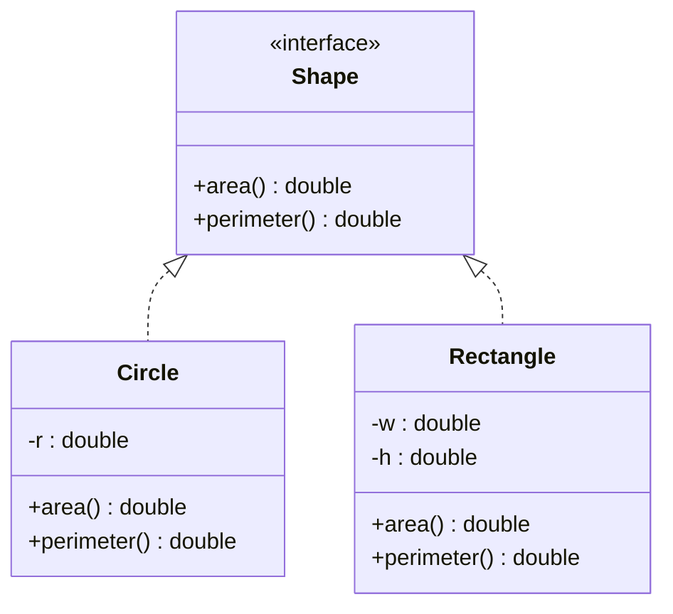

# Object-Oriented Programming in Java

| | |
|---|---|
| **Journal** | Journal 1 (Weeks 1–4) |
| **Evidence for** | Section 1, row 2 – Object-oriented programming |
| **Module** | Fundamental Module 1 – Fundamentals of Programming in Java |
| **Covers** | Classes, objects, constructors, encapsulation, inheritance, overriding, polymorphism, abstract classes, interfaces |

---

## 1. Why object-oriented programming?

Procedural code separates data from the functions that use it. In object-oriented programming (OOP), data and behaviour are bundled together into **objects**. This makes large programs easier to organise, reuse and change.

| Pillar | One-line meaning |
|---|---|
| **Encapsulation** | Hide internal data; expose it through a controlled interface. |
| **Inheritance** | A class can reuse and extend another class. |
| **Polymorphism** | One interface, many behaviours. |
| **Abstraction** | Show what an object does, hide how it does it. |

---

## 2. Classes, objects and constructors

A **class** is a blueprint. An **object** is one instance built from it.

```java
public class Student {
    // fields (state)
    private String name;
    private int id;
    private double gpa;

    // constructor: runs when an object is created
    public Student(String name, int id, double gpa) {
        this.name = name;
        this.id = id;
        this.gpa = gpa;
    }

    // method (behaviour)
    public String summary() {
        return id + " - " + name + " (GPA " + gpa + ")";
    }
}
```

```java
Student s = new Student("Pema", 101, 3.4);
System.out.println(s.summary());
```

**Notes**

- A constructor has the same name as the class and no return type.
- `this` refers to the current object. It separates a field (`this.name`) from a parameter (`name`).
- If no constructor is written, Java supplies a default one with no parameters. Once any constructor is written, the default one is no longer provided.
- Constructors can be overloaded to allow different ways of creating an object.

---

## 3. Encapsulation

Fields are made `private` and accessed through public getters and setters. This allows validation and protects the object's state.

```java
public class BankAccount {
    private double balance;

    public double getBalance() { return balance; }

    public void deposit(double amount) {
        if (amount <= 0) throw new IllegalArgumentException("Deposit must be positive");
        balance += amount;
    }

    public void withdraw(double amount) {
        if (amount > balance) throw new IllegalStateException("Insufficient funds");
        balance -= amount;
    }
}
```

| Modifier | Same class | Same package | Subclass | Everywhere |
|---|:---:|:---:|:---:|:---:|
| `private` | ✔ | | | |
| *(default)* | ✔ | ✔ | | |
| `protected` | ✔ | ✔ | ✔ | |
| `public` | ✔ | ✔ | ✔ | ✔ |

---

## 4. Inheritance and method overriding

A subclass uses `extends` to inherit fields and methods from a superclass. `super` calls the parent constructor or method.

```java
class Employee {
    protected String name;
    protected double baseSalary;

    Employee(String name, double baseSalary) {
        this.name = name;
        this.baseSalary = baseSalary;
    }

    double salary() { return baseSalary; }
}

class Manager extends Employee {
    private double bonus;

    Manager(String name, double baseSalary, double bonus) {
        super(name, baseSalary);          // call the parent constructor
        this.bonus = bonus;
    }

    @Override
    double salary() {                     // overriding: same signature, new behaviour
        return super.salary() + bonus;
    }
}
```

| | Overloading | Overriding |
|---|---|---|
| Where | Same class | Parent and child class |
| Signature | Different parameters | Same parameters |
| Resolved | At compile time | At run time |
| Purpose | Convenience | Specialised behaviour |

Java allows a class to extend only **one** class, but it can implement many interfaces.

---

## 5. Polymorphism, abstract classes and interfaces

### Abstract class

An abstract class cannot be instantiated. It can hold shared state and both implemented and abstract methods.

### Interface

An interface describes a contract: *what* a class can do. A class that `implements` it must provide the methods.

```java
interface Shape {
    double area();
    double perimeter();
}

class Circle implements Shape {
    private final double r;
    Circle(double r) { this.r = r; }
    public double area()      { return Math.PI * r * r; }
    public double perimeter() { return 2 * Math.PI * r; }
}

class Rectangle implements Shape {
    private final double w, h;
    Rectangle(double w, double h) { this.w = w; this.h = h; }
    public double area()      { return w * h; }
    public double perimeter() { return 2 * (w + h); }
}
```

### Polymorphism in action

A variable of the interface type can hold any implementing object. The correct method is chosen at run time. (Put this class in the same project as the `Shape`, `Circle` and `Rectangle` code above.)

```java
public class ShapeDemo {
    public static void main(String[] args) {
        Shape[] shapes = { new Circle(2), new Rectangle(3, 4) };
        for (Shape s : shapes) {
            System.out.printf("Area = %.2f, Perimeter = %.2f%n", s.area(), s.perimeter());
        }
    }
}
```

**Expected output**

```
Area = 12.57, Perimeter = 12.57
Area = 12.00, Perimeter = 14.00
```

| | Abstract class | Interface |
|---|---|---|
| Instance fields | Yes | No (constants only) |
| Constructors | Yes | No |
| Multiple inheritance | No | A class can implement many |
| Best used for | Shared base behaviour ("is-a" with common code) | A capability or contract |

---

## 6. Class relationships



| Relationship | Meaning | Example |
|---|---|---|
| Inheritance | "is-a" | `Manager` is an `Employee` |
| Realisation | class implements interface | `Circle` implements `Shape` |
| Association | "uses" | `Student` uses `Course` |
| Composition | "has-a", part cannot exist alone | `House` has `Room` |

**Design tip:** prefer composition over inheritance when the relationship is "has-a" rather than "is-a".

---


## References

Oracle. (n.d.). *Object-oriented programming concepts*. In *The Java™ tutorials*. https://docs.oracle.com/javase/tutorial/java/concepts/
