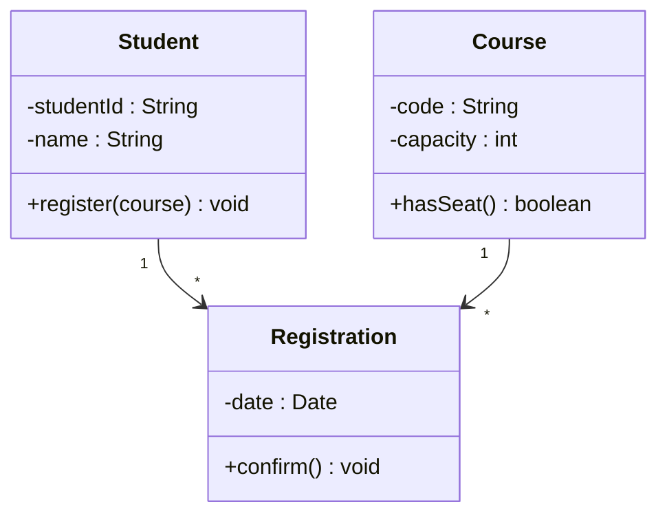

# Software Design and Architecture – Course Notes and Design Exercise

| | |
|---|---|
| **Journal** | Journal 1 (Weeks 1–4) |
| **Evidence for** | Section 1, row 4 – Software design and architecture |
| **Module** | Fundamental Module 3 – Software Design and Architecture |
| **Online course** | Software Design and Architecture Specialization (University of Alberta, Coursera) |
| **Covers** | Design principles, UML class diagrams, responsibilities, coupling and cohesion, intro to patterns and architecture |


---

## 1. Design vs architecture

| | Software design | Software architecture |
|---|---|---|
| Scope | Inside a component: classes, methods, interactions | The whole system: major components and how they connect |
| Questions | "How should these classes collaborate?" | "How is the system divided and deployed?" |
| Typical output | Class diagrams, sequence diagrams | Component diagrams, layered or client–server structure |

Both aim at software that is **maintainable, reusable, flexible and testable**.

---

## 2. Core design principles

| Principle | Meaning | Violation looks like |
|---|---|---|
| **Single Responsibility** | A class has one reason to change | A `Report` class that calculates, formats, prints and saves |
| **Open/Closed** | Open for extension, closed for modification | Adding a new payment type means editing a big `if/else` |
| **Liskov Substitution** | A subclass can replace its parent without breaking behaviour | `Square extends Rectangle` that breaks width/height assumptions |
| **Interface Segregation** | Prefer small, focused interfaces | A `Machine` interface forcing a printer to implement `fax()` |
| **Dependency Inversion** | Depend on abstractions, not concrete classes | A service that does `new MySqlDatabase()` inside itself |
| **DRY** | Do not repeat knowledge | Same validation copied in five places |
| **KISS** | Keep it simple | A pattern added "just in case" |

### Coupling and cohesion

- **Cohesion** – how closely the parts of one class belong together. *Aim for high.*
- **Coupling** – how much one class depends on another. *Aim for low.*

---

## 3. Responsibilities and relationships (UML)

A class diagram shows classes, their attributes and methods, and relationships.



Reading it: a student can have many registrations, a course can have many registrations, and each registration links one student to one course.

---

## 4. Small design exercise – course registration

**Requirement:** students register for courses; a course has limited seats; the system confirms or rejects the request.

**Step 1 – find the nouns (candidate classes):** Student, Course, Registration.

**Step 2 – assign responsibilities**

| Class | Responsibility |
|---|---|
| `Student` | Holds student details; starts a registration request |
| `Course` | Knows its capacity and current seat count |
| `Registration` | Links a student and a course; records the outcome |
| `RegistrationService` | Applies the rule "confirm only if a seat is free" |

**Step 3 – check the principles:** the seat rule sits in `RegistrationService`, not in `Student`, so each class keeps a single responsibility, and rules can change without touching the data classes.

```java
class RegistrationService {
    boolean register(Student student, Course course) {
        if (!course.hasSeat()) return false;
        course.addStudent(student);
        return true;
    }
}
```

---

## 5. A first look at design patterns

| Pattern | Problem it addresses | Example use |
|---|---|---|
| Singleton | Only one instance should exist | Configuration manager |
| Factory | Creating objects without naming the exact class | Choosing a payment handler |
| Observer | Many objects must react to one change | Notifications |
| Strategy | Swap algorithms at run time | Different sorting or pricing rules |

## 6. A first look at architectural styles

| Style | Idea | Typical use |
|---|---|---|
| Layered | Presentation → Business logic → Data | Most web and desktop apps |
| Client–server | Clients request, server responds | Web applications |
| MVC | Separate model, view and controller | UI-centred apps |

## References

Gamma, E., Helm, R., Johnson, R., & Vlissides, J. (1994). *Design patterns: Elements of reusable object-oriented software*. Addison-Wesley.

University of Alberta. (n.d.). *Software design and architecture specialization* [Online course]. Coursera. https://www.coursera.org/specializations/software-design-architecture
