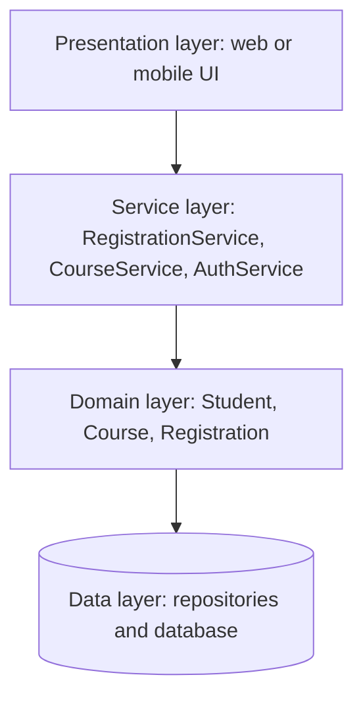
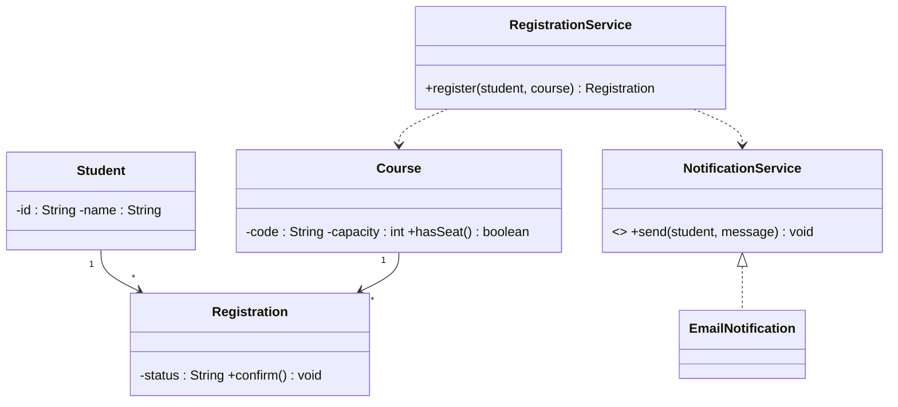

# Software Design and Architecture Specialization – Notes and Design Exercise

| | |
|---|---|
| **Journal** | Journal 3 (Weeks 9–12) |
| **Evidence for** | Section 1, row 3 – Software design and architecture |
| **Online course** | Software Design and Architecture Specialization (University of Alberta, Coursera) |
| **Courses** | Object-Oriented Design, Design Patterns, Software Architecture, Service-Oriented Architecture |
| **Status** | Completed |


---

## 1. Object-oriented design

- Identify classes from requirements, assign responsibilities, then define relationships.
- Document designs with UML class and sequence diagrams.
- Apply SOLID, keep coupling low and cohesion high (see `../journal-1-weeks-1-4/04-software-design-and-architecture.md` for the principle table).

## 2. Design patterns

| Pattern | Category | Intent | Java sketch |
|---|---|---|---|
| Strategy | Behavioural | Swap algorithms at run time | `interface Pricing { double price(double base); }` |
| Observer | Behavioural | Notify dependants of a change | `subject.attach(observer)` |
| Factory Method | Creational | Create objects without naming the class | `PaymentFactory.create("card")` |
| Singleton | Creational | One shared instance | private constructor, static `getInstance()` |
| Decorator | Structural | Add behaviour by wrapping | `new Milk(new Coffee())` |
| MVC | Architectural pattern | Separate data, UI and control | Model, View, Controller classes |

```java
interface DiscountStrategy { double apply(double amount); }

class NoDiscount implements DiscountStrategy {
    public double apply(double amount) { return amount; }
}
class StudentDiscount implements DiscountStrategy {
    public double apply(double amount) { return amount * 0.9; }
}

class Checkout {
    private final DiscountStrategy strategy;
    Checkout(DiscountStrategy strategy) { this.strategy = strategy; }
    double total(double amount) { return strategy.apply(amount); }
}
```

New discount rules are added as new classes. `Checkout` never changes, which follows the Open/Closed principle.

## 3. Software architecture

| Style | Description | Strengths | Weaknesses |
|---|---|---|---|
| Layered | Presentation, business, data layers | Simple, easy to test | Can become slow or rigid |
| Client–server | Clients call a central server | Central control | Server is a bottleneck |
| Service-oriented | Reusable services over a network | Reuse, loose coupling | More complexity |
| Microservices | Small independently deployed services | Scales and deploys independently | Operational overhead |

**Quality attributes** guide architecture decisions: performance, scalability, security, maintainability, availability, modifiability. Improving one often costs another, so choices need a stated reason.

## 4. Service-oriented architecture

- Services communicate through defined interfaces, using web services such as **REST** (HTTP with JSON) or **SOAP** (XML messages).
- Example REST calls: `GET /courses`, `POST /registrations`.
- Benefits: services can be reused and changed independently, and clients and servers can use different technologies.

---

## 5. Design exercise – Course Registration System

### Requirements
1. Students log in and view available courses.
2. A student can register for a course if seats are available.
3. Administrators add courses and set capacity.
4. Students receive a confirmation.

### Architecture (layered)



### Class design



### Component responsibilities

| Component | Responsibility |
|---|---|
| `Student`, `Course`, `Registration` | Hold domain data and simple rules (`hasSeat`) |
| `RegistrationService` | Applies the registration rule and coordinates the steps |
| `NotificationService` (interface) | Sends confirmations; the implementation can change (email, SMS) |
| Repositories | Hide how data is stored |

### Design rationale

| Decision | Reason |
|---|---|
| Layered architecture | Clear separation, each layer can be tested on its own |
| Registration rule in a service | Keeps domain classes simple (Single Responsibility) |
| Notification behind an interface | New channels added without changing `RegistrationService` (Open/Closed, Dependency Inversion) |
| Repositories for storage | The database can change without touching business rules |

**Trade-off:** a layered design adds a few extra classes and calls, but it makes the system easier to change and test, which matters more than a small amount of extra code in a system that will grow.

## 6. Still to practise

- Producing a complete design from an unfamiliar set of requirements
- Defending design choices when requirements conflict

## References

Gamma, E., Helm, R., Johnson, R., & Vlissides, J. (1994). *Design patterns: Elements of reusable object-oriented software*. Addison-Wesley.

University of Alberta. (n.d.). *Software design and architecture specialization* [Online course]. Coursera. https://www.coursera.org/specializations/software-design-architecture
